### `$ ls ~/projects`

  
  
  
  
  
  

### `$ tail -f activity.log`

<picture>
  <source media="(prefers-color-scheme: dark)" srcset="https://raw.githubusercontent.com/leolennards/leolennards/output/github-snake-dark.svg">
  
</picture>

